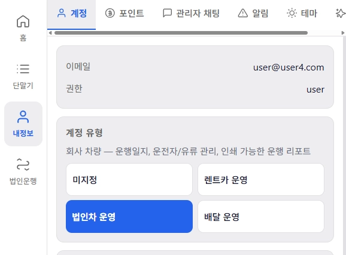
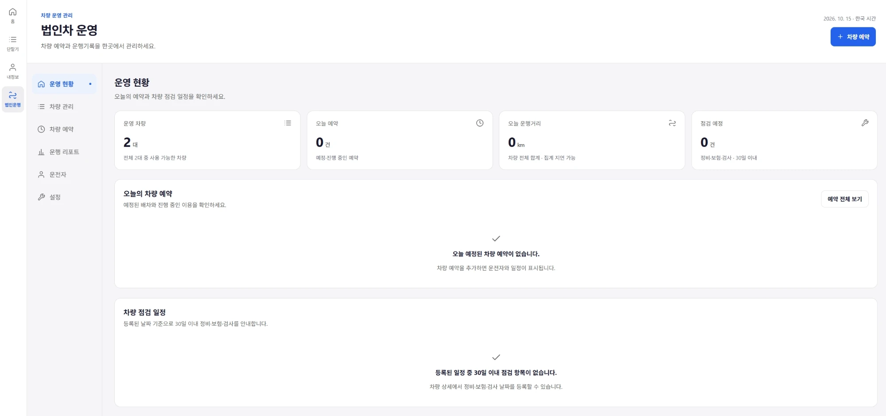
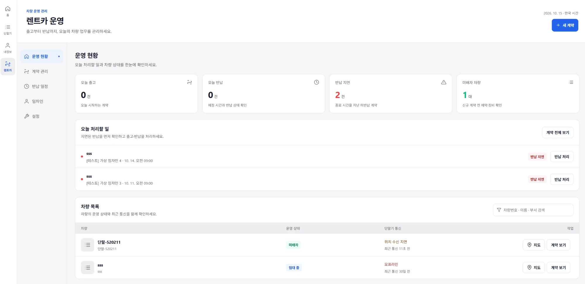
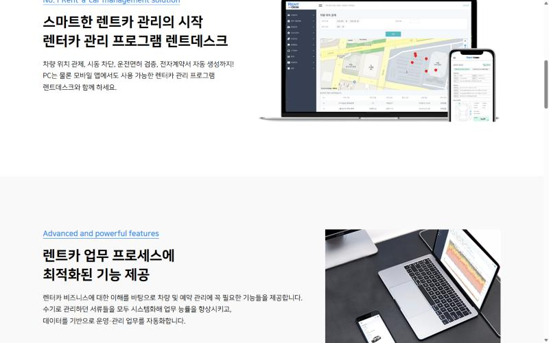
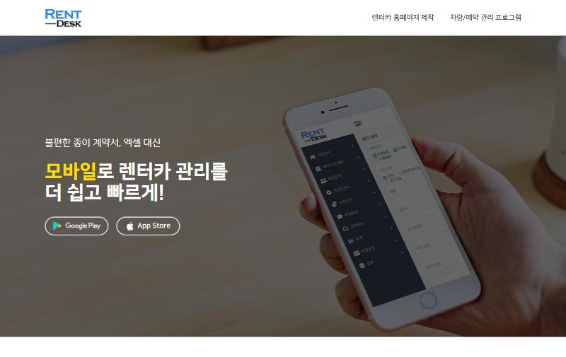
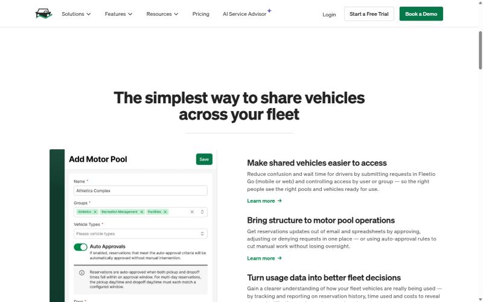
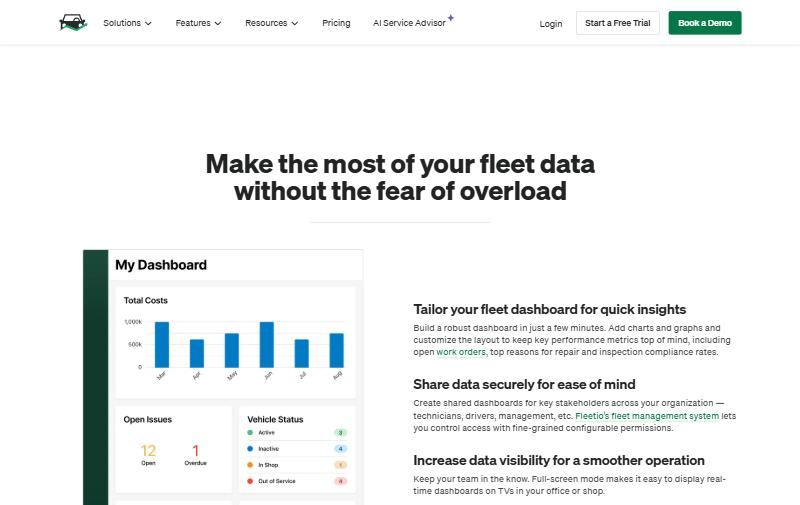
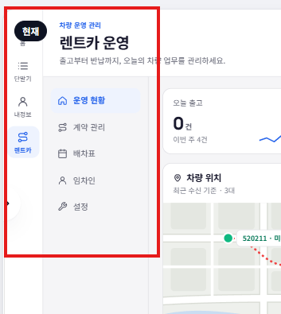
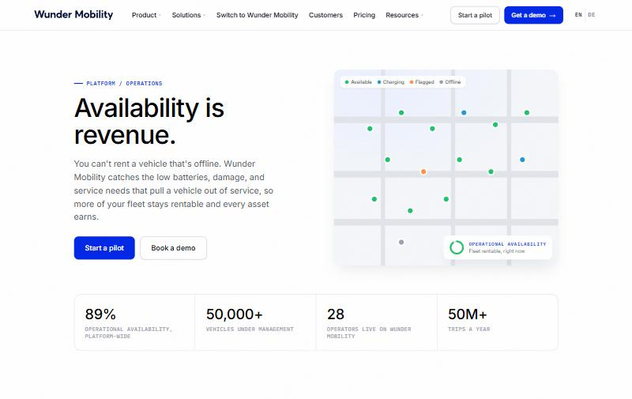
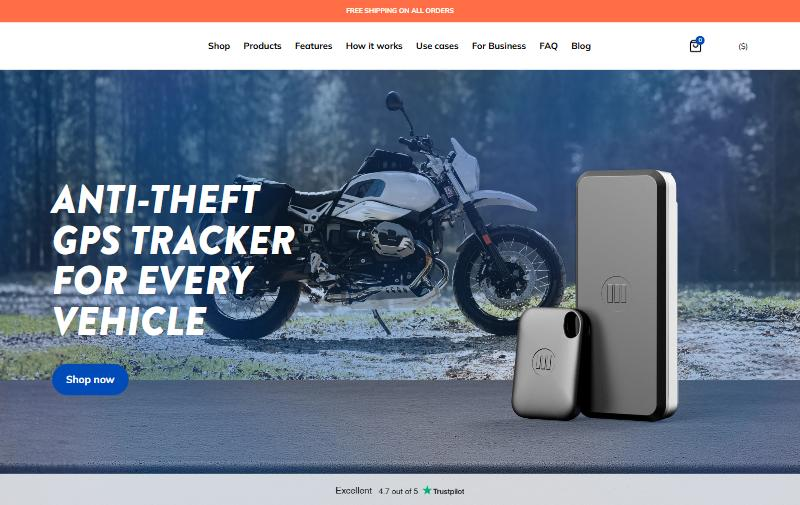

# 법인차 · 렌트카 관리 페이지 벤치마킹 (2026-10-15)

> 목적: 계정 유형 `법인차 운영` / `렌트카 운영` 관리 페이지의 디자인·기능 방향 정리.
> 범위: 법인차 · 렌트카 위주. 배달·GPS 단말기 서비스는 참고만.
> 기준 코드: `server/dev-aligned-20261015` (`120a144`, dev 서버와 동일).

---

## 0. 현재 우리 화면

| 계정 유형 선택 | 법인차 운영 | 렌트카 운영 |
|---|---|---|
|  |  |  |

**이미 있는 것** (코드 기준)

- 법인차 (`CorporatePanel.jsx`): 운영 현황 · 차량 관리 · 차량 예약 · 운행 리포트(국세청 별지 73호 / 우리 양식, PDF·엑셀) · 운전자 · 설정, 운행별 용무/운전자/유류 입력, 정비·보험·검사 30일 알림, 차량 서류 업로드
- 렌트카 (`RentcarPanel.jsx`): 운영 현황 · 계약 관리 · 반납 일정(캘린더) · 임차인(블랙리스트 경고/차단) · 설정, 인수·반납 QR 링크 + 사진·연료·주행거리 기록, 청구서 다운로드

**지금 화면의 문제**

1. 법인차 첫 화면이 비어 보임 — 예약 0건·점검 0건이면 빈 상태 카드 2개가 화면 대부분을 차지.
2. 지도(GPS)가 관리 화면과 분리 — 렌트카는 행마다 `지도` 버튼만 있고, 법인차는 위치 정보가 첫 화면에 없음.
3. 법인차의 핵심 가치(운행일지 자동화, 유류비)가 첫 화면에 안 보임 — 계정 유형 설명에는 있는데 운영 현황에는 없음.
4. 렌트카 차량 목록에 `위치 수신 지연`/`오프라인`이 보이지만, 계약 상태와 엮인 경고(예: 임대 중인데 30일 오프라인)가 없음.

---

## 1. 벤치마킹 대상

| 서비스 | 분야 | 참고 포인트 |
|---|---|---|
| **RentDesk (휴비넷)** | 국내 렌트카 ERP | 지도+목록 한 화면, 모바일 차량 체크, 전자계약서, 소모품 알림 |
| **SK렌터카 스마트링크** | 국내 법인차 관제 | 국세청 양식 운행기록 자동, 주유·하이패스 비용 통합 |
| **쏘카 FMS / 쏘카 비즈니스** | 국내 법인차 공유 | 직원 예약·키 관리, 부정 사용·부정 주유 감지 |
| **롯데렌터카 오토매니저** | 국내 법인차 | PC·모바일 예약, 유류비·통행료 자동 기록 |
| **Fleetio** | 해외 차량 관리 | Motor Pool(차량 예약 승인), 커스텀 대시보드, 유류 로그 |
| **RentHub / RENTALL / RentWorks** | 해외 렌트카 | 손상 도면 마커, 손상 이력 타임라인, 지점별 가용 현황 |
| Samsara / Geotab | 해외 관제 | 실시간 GPS, 공회전·운전습관 (참고만) |
| Onfleet, 배민-대행사 연동 | 배달 | 라이더 실시간 위치, 자동 배차 (이번 범위 밖) |

---

## 2. 렌트카 — 서비스별 분석

### RentDesk (휴비넷) — 국내 직접 경쟁

출처: <https://rentdesk.co.kr/erp.php> · 요금: 차량 50대까지 월 5만원

| 기능 | 우리 상태 | 판단 |
|---|---|---|
| 지도 + 차량 목록을 한 화면에 (위 캡처: 좌측 메뉴, 상단 검색, 중앙 지도, 하단 목록) | 지도와 관리 화면이 분리됨 | **흡수** — 운영 현황에 미니맵 추가 |
| 모바일에서 차량 외관 체크 (차 도면에 손상 표시) | QR 링크로 사진 업로드만 | **흡수** — 도면 위 손상 마커 |
| 온라인 임대차 계약서 → 전자서명 → SMS 발송 | 청구서 다운로드만 | **흡수 (2단계)** — 인수 링크에 서명 추가 |
| 운전면허 자동 검증 | 없음 | **보류** — 외부 API·비용 확인 필요 |
| 시동 차단 · 도어/경적 원격제어 | 없음 | **불필요** — 우리 단말기(ESP32)로 불가 |
| 소셜커머스(쿠팡 등) 티켓 연동, 쿠폰·포인트 | 없음 | **불필요** — 소규모 업체 대상, 범위 밖 |
| 소모품 교체 주기 알림 (엔진오일·타이어) | 정비·보험·검사 날짜만 | **흡수** — 날짜 + 주행거리 기준 |
| 가동률 · 매출 통계 리포트 | 없음 | **흡수** — 가동률은 GPS·계약 데이터로 계산 가능 |

### RentHub / RENTALL / RentWorks — 해외 렌트카

출처: [RentHub 기능](https://www.renthubsoftware.com/en/car-rental-software-and-cloud-management/vehicle-fleet-management-car-rental-software-features/) · [RENTALL](https://capterra.com/p/119277/RENTALL/) · [RentWorks Plus](https://www.getapp.co.uk/software/2141629/rentworks-plus)

- **Planning(간트형 배차표)**: 차량 = 행, 날짜 = 열, 계약 = 막대. 빈 차량·겹침을 한눈에. → **흡수**. 지금의 월 캘린더보다 렌트카 업무에 맞음.
- **손상 이력 타임라인**: 차량별로 손상 사진이 시간순으로 쌓임. 반납 시 인수 때와 비교. → **흡수**. 이미 인수/반납 사진이 있으니 차량 상세에 모아서 보여주기만 하면 됨.
- **거리·날짜 기준 마감 알림**: 정비를 날짜뿐 아니라 km로도. → **흡수**.
- **한 화면 체크인/체크아웃**: 반납 처리를 다이얼로그 하나로. → 지금 구조 유지, 단계만 줄이기.
- **지점별 가용 현황, 브로커·마켓플레이스 연동**: → **불필요** (단일 지점 소규모 대상).

---

## 3. 법인차 — 서비스별 분석

### Fleetio — Motor Pool / Dashboard

출처: [Motor Pool](https://www.fleetio.com/features/motor-pool) · [Dashboards](https://www.fleetio.com/features/fleet-management-dashboards)

| 기능 | 우리 상태 | 판단 |
|---|---|---|
| 직원이 차량 예약 신청 → 관리자 승인/반려, 조건 맞으면 **자동 승인** | 관리자가 직접 예약 등록 | **흡수** — 직원 신청 링크 + 승인 큐 |
| 예약 이력·사용 시간·비용으로 차량 이용률 리포트 | 월간 거리 집계만 | **흡수** — 차량별 이용률(%) |
| 대시보드 위젯: 총비용 차트, 미해결 이슈(열림/기한초과), 차량 상태 분포 | 숫자 카드 4개 | **흡수** — 차량 상태 분포 + 비용 추이 |
| 대시보드 TV 전체화면 모드, 위젯 자유 배치 | 없음 | **불필요** — 소규모 고객엔 과함 |
| 정비 작업지시서(Work order), 부품 재고 | 없음 | **불필요** |

### SK렌터카 스마트링크 · 쏘카 FMS · 롯데 오토매니저 — 국내 법인차

출처: [스마트링크 앱](https://apps.apple.com/us/app/%EC%8A%A4%EB%A7%88%ED%8A%B8%EB%A7%81%ED%81%AC-%ED%86%B5%ED%95%A9/id1661603946?l=ko) · [쏘카 FMS 기사](https://www.fnnews.com/news/202403130916131440) · [LG U+ 운행일지 안내](https://www.lguplus.com/biz/insight/story/735) · [SK렌터카 법인 조사 기사](https://www.heraldk.com/article/2026090318410442814)

- **공통 핵심 = 운행일지 자동 작성 (국세청 양식)**. SK렌터카 조사(465개 기업)에서도 법인 고객 선택 기준이 "가격 → 업무 부담 감소"로 이동. → 우리도 이미 있음. **첫 화면에 "이번 달 운행일지 n% 작성됨" + 바로 출력 버튼**으로 전면 배치.
- **주유·하이패스 비용 통합** (스마트링크, 쏘카, 오토매니저 모두). → 유류는 운행별 입력이 있음. **흡수**: 월별 유류비 합계 카드 + 영수증 사진 첨부. 하이패스 카드 연동은 **보류** (외부 연동 필요).
- **부정 사용 감지** (쏘카: 업무 외 시간 운행, 부정 주유). → **흡수**: 예약 없는 시간대 운행 / 업무시간 외 운행 알림. GPS 데이터만으로 가능.
- **업무/비업무 시간 설정** (휴맥스 FMS). → **흡수**: 설정 탭에 업무시간 입력 → 위 알림 기준.
- **키리스(스마트키), 대체 차량 연계** (쏘카). → **불필요** — 하드웨어·제휴 필요.

---

## 4. 작업 방향 (제안)

### 렌트카

| 우선 | 작업 | 근거 |
|---|---|---|
| P1 | **운영 현황에 미니맵**: 임대 중 / 미배차 / 반납 지연 차량 색상 구분 | RentDesk |
| P1 | **배차표(간트)** 뷰를 반납 일정에 추가 (월 캘린더와 토글) | RentHub Planning |
| P1 | **통신 이상 × 계약 상태 경고**: 임대 중인데 오프라인 n시간 이상 → 할 일 목록 상단 | 우리 강점(GPS) |
| P2 | 차량 상세에 **손상 사진 타임라인** (인수/반납 사진 모음) | RentHub, RENTALL |
| P2 | 인수 링크에 **도면 손상 마커 + 전자서명** | RentDesk, RentHQ |
| P2 | **가동률 리포트**: 차량별 임대일/전체일, 월 매출 | RentDesk 통계 |
| P3 | 소모품 알림 **km 기준** 추가 | RentDesk, RentHub |

### 법인차

| 우선 | 작업 | 근거 |
|---|---|---|
| P1 | **첫 화면 재구성**: 빈 카드 2개 대신 ① 미니맵 ② 이번 달 운행일지 작성률 + 출력 버튼 ③ 최근 운행 5건 | 스마트링크·쏘카 공통 |
| P1 | 빈 상태는 **한 줄로 축소** (예약 0건이면 높이 낮게) | 현재 문제 1 |
| P1 | **유류비 월 합계 카드** (운행별 입력값 합산) | 스마트링크, 오토매니저 |
| P2 | **직원 예약 신청 → 관리자 승인** 흐름 (+ 자동 승인 조건) | Fleetio Motor Pool |
| P2 | **업무시간 설정 + 업무 외 운행 알림** | 쏘카, 휴맥스 FMS |
| P2 | **차량별 이용률** 리포트 | Fleetio |
| P3 | 영수증 사진 첨부 (유류) | 오토매니저 |

### 하지 않을 것

- 시동 차단 · 원격 도어 제어 · 스마트키 → 단말기 하드웨어로 불가
- 소셜커머스 연동, 쿠폰·포인트 → 대상 고객(소규모)과 맞지 않음
- 대시보드 위젯 자유 배치, TV 모드 → 과함
- 정비 작업지시서·부품 재고 → 범위 밖
- 하이패스 카드 / 운전면허 검증 API → 비용·제휴 확인 후 재검토

---

## 5. 참고 — 배달 (이번 범위 밖)

- 배민이 주요 배달대행사 6곳과 라이더 위치 연동 완료 (2026-07). 배달 쪽은 "라이더 실시간 위치 + 배차 상태"가 기본 기대치. [기사](https://v.daum.net/v/20260727162246267)
- Onfleet: 자동 배차, 드라이버 위치·ETA를 한 화면에, 배송 완료 사진·서명. [링크](https://onfleet.com/assignment-and-dispatching)
- 현재 `DeliveryPanel.jsx`(172줄)는 기본 수준. 법인차·렌트카 정리 후 검토.

---

## 6. 2차 피드백 반영 (메뉴 · 모바일 · 차별화 · 오토바이)

시안 페이지: [proposal.html](proposal.html) (데스크톱·휴대폰 시안, 한국어/O'zbekcha)

### 6-1. 메뉴 한 겹으로 (피드백: 왼쪽 메뉴 영역이 불편)

- 현재: 전체 메뉴 64px + 업무 메뉴 172px + 제목·설명 헤더 약 93px. 같은 역할의 메뉴가 두 군데.
- 제안: 업무 메뉴를 헤더 탭으로 올림 → 화면 폭 +172px(+16%), 헤더 93 → 60px, 선택 2단계 → 1단계.
- 설명 문구("출고부터 반납까지…") 대신 실시간 상태 한 줄. 헤더에 검색(Ctrl K, 기존 CommandPalette 재사용).
- 모바일: 업무 계정은 하단 탭 자체를 업무 메뉴로 (현황 · 배차표 · + · 지도 · 더보기). 현재는 하단 탭(BottomNav.jsx) → '렌트' → 다시 상단 탭의 두 겹.

### 6-2. 모바일 우선

- 하단 탭 + 가운데 큰 버튼(새 계약/예약), 목록 스와이프로 처리, 단계는 하단 시트(반납: 확인 → 주행·연료 → 사진 → 정산), 지도는 전체 화면 + 끌어올리는 목록.
- 터치 영역 44px 이상, 주요 버튼은 엄지가 닿는 아래쪽.

### 6-3. 차별화: GPS 자동 감지 + 원탭 처리

"기록은 차가, 확인은 사람이." GPS가 감지한 사실을 할 일·알림으로 바로 바꾸고, 사람은 확인 한 번.

| 유형 | 감지 | 자동 처리 | 사람 |
|---|---|---|---|
| 렌트카 | 본사 주차장(지오펜스) 진입 | GPS 주행거리로 초과 km 계산, 반납 사진 링크 발송 | [정산 확인] |
| 법인차 | 운행 종료 | 운행기록 분할, 운전자에게 용무 선택 요청 | 월말 [국세청 양식 출력] |
| 배달 | 주차 모드 중 이동 | 경로 저장, 긴급 알림 | [위치 공유] |

- 이미 있는 것 (코드 확인): 지오펜스, 운행 자동 분할(corporate trips), 신호 끊김 알림(connection_alert_episodes), 과속·급가감속·야간 판별(ai.rs), 인수·반납 링크, 위치 공유 링크, 카카오 알림톡, FCM 푸시.
- 새로 만들 것: 규칙 화면, 감지 → 할 일 연결, 알림 속 버튼, 아침 브리핑.

### 6-4. 배달 · 오토바이 벤치마킹

| 서비스 | 특징 | 판단 |
|---|---|---|
| **에이링크** (SK렌터카 × 에이렌탈앤서비스, 2025. 8.) | 스마트링크 기반 이륜차 전용 관제. GPS 위치·운행기록·이상 감지. 에이렌탈은 배민·쿠팡이츠 등 배달 업종에 이륜차 렌털 | 국내 직접 경쟁. 위치·기록은 우리도 있음 → **이상 감지를 규칙으로** |
| **Wunder Mobility** | "Availability is revenue". 상태 색 지도(사용 가능/충전/점검/오프라인), 문제 → 우선순위 작업 → 현장 담당자 | **흡수**: 상태 색 지도, 문제를 할 일로 |
| **Fleeti** (이륜차 배송) | 근무 외 이동 감지, 거점 안전구역 이탈 알림, 배송 증빙 | **흡수**: 구역 이탈 · 근무 외 이동. 배송 증빙은 보류 |
| **Monimoto** | 오토바이 도난 방지 트래커. 경보 모드 중 움직이면 1분 안에 전화 | **흡수**: 주차 모드 + 긴급 알림 |
| **ZyppDash** (인도, 전기 스쿠터) | 라이더·차량 실시간 위치, 근무 중 라이더 관리 | 참고 |

제안: 매장 반경 구역 지도, 지금 확인할 일(과속·구역 이탈·폰 신호 없음), 주차 모드 도난 감지, 라이더 안전 점수(기존 AI 분석의 과속·급가감속·야간 판별 재사용), 폰 앱(기존 phone 단말기)으로도 시작.

출처: [에이링크 기사](https://www.sidae.com/article/2025080708515382872) · [Wunder Operations](https://www.wundermobility.com/en/platform/operations) · [Fleeti 이륜차](https://en.fleeti.co/secteurs/coursiers-2-roues) · [Monimoto](https://monimoto.com) · [ZyppDash 기사](https://autocarpro.in/news/zypp-electric-launches-zyppdash-fleet-management-dashboard-113943)

---

## 캡처 관련 메모

- 캡처는 각 서비스 공개 마케팅 페이지 (로그인 화면 아님). 실제 관리자 화면은 데모 신청이 필요.
- 스마트링크·쏘카 FMS는 공개된 관리자 화면 이미지가 없어 기능 설명만 정리.
- Samsara 페이지는 영상 위주라 캡처에서 제외.
