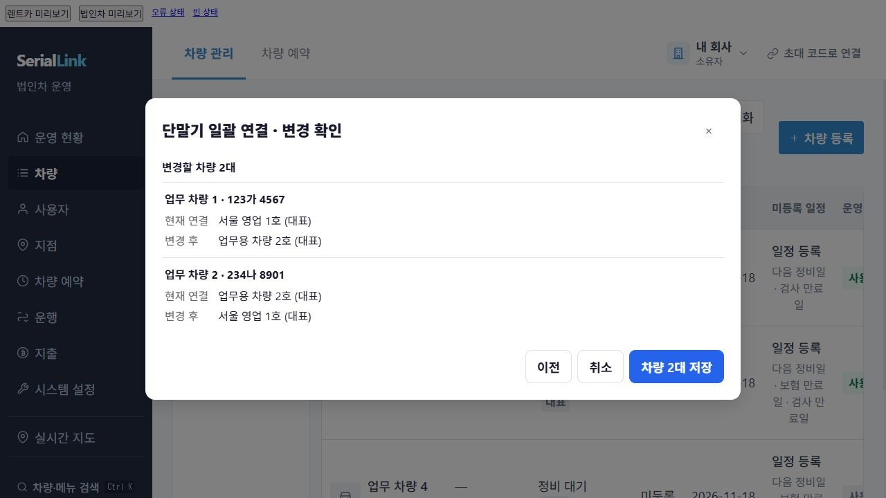
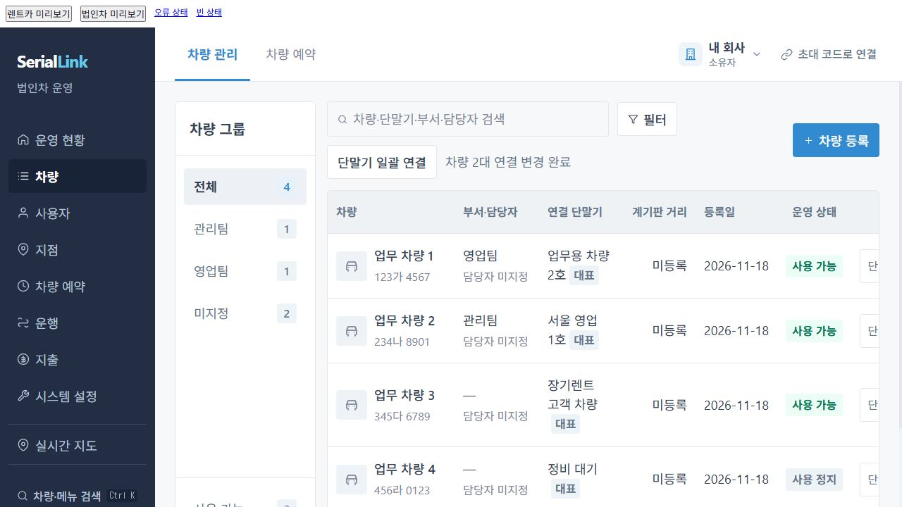

# 147차 dev 법인차 검토 증거 — 2026-11-19

[판정·대상·남은 보완](../../operations/location-business-dev-review147-20261119.md)을 먼저 읽는다. **제품 코드 병합/배포 증거가 아니라, 동료가 dev에 배포한 변경의 독립 검토 증거**다.

## 실행 결과

| 파일 | 의미 |
| --- | --- |
| `targeted-web-tests.log` | dev412ab438 관련 웹78개 통과 |
| `test_fleet_assets.py.log` | 실제 dev API + 합성DB 기능34개 통과 |
| `backend-extra.py.log` | 회사별 권한, 실제 교환 전후 이력 동일, 일정 보존9개 통과 |
| `health.json` | 네트워크 없는 격리 API의 정상 응답 |
| `cleanup.json` | 해당 컨테이너 제거, 기존 실행 컨테이너 목록 불변, API 해시 |
| `dev-source-after.txt` | 검토 후 dev HEAD/clean 상태, 실제 웹 경로와 API 해시 |
| `dev-health-after.json`, `prod-health-after.json` | 개발/운영 공개 API 응답. 운영은runtime145 유지 |
| `dev-web-version.json`, `prod-web-version.json` | 실제 제공 웹 버전, 두 환경schema115 |
| `source-diff-numstat.txt` | 직전 검토dev fb705249 대비33파일 변경 범위 |

웹 실행은 dev worktree의 `gps-tracker-web`에서 다음과 같다. 기존 설치된 node_modules를 사용했고 의존성 변경은 없다.

```powershell
node --experimental-vm-modules --test tests/fleet-batch-bindings.test.mjs tests/fleet-assets-ui.test.mjs tests/corporate-overview.test.mjs tests/corporate-trip-report.test.mjs tests/corporate-workspace.test.mjs tests/nts-report.test.mjs
```

`run-backend.py`는 빌드 호스트의 `/home/etcom-hub/build/gps-review147-20261119`와 지정 해시의 dev 실행 파일·기존 Docker 이미지에 한정한 재현 도구다. 복사된 실제 API에 대해 네트워크 없는 일회용 컨테이너를 만들고 새 합성DB로 실행한다. 프로덕션 실행 도구가 아니다. `backend-extra.py`의 인물/계정/위치와 암호는 합성이며 실제 자격증명이 아니다. API 바이너리·실제 DB·실제 환경/키는 공개 Git에 넣지 않았다.

## 실패와 시험 사본 보정

- `test_fleet_assets-original.py`: 동료 dev 테스트 원본.
- `initial-legacy-fixture-failure.log`: 고정2026-10 날짜와 현재월 집계 불일치, 합성 사용자 정리 중 privacy_account_controls FK 실패.
- `test_fleet_assets-adapted.py`: 현재월 표본과 합성 계정 종속행 정리만 바꾼 실행 사본. 변경을 수행한 코드는 `run-backend.py`에 있다. 제품/API 구현은 바꾸지 않았다.
- `initial-inactive-manager-hypothesis.log`: “비활성 담당자의 일정 저장이400일 것”이라는 초기 가설이 틀려 실패한 검사다. 실제로는200이며 변경 없는 배정은 허용된다. 최종 추가9항목에서200과 나머지 필드 보존을 검사했다. 제품 결함으로 세지 않는다.

## 실제 UI 캡처 — 로컬 합성 미리보기

`412ab438`의 실제 React 컴포넌트를 `business-preview.html?kind=corporate&mock-map=1`로 열었다. API는 이 미리보기의 메모리 fixture이며 운영/dev의 차량을 수정하지 않았다. 날짜 입력 자동화의 초기 fill이 React 상태를 바꾸지 않아 실제 키 입력 후 저장했다. 저장 버튼 활성화와 후속 목록 상태로 완료를 판정했다.

1. `preview-missing-schedules.jpg`: 차량1의 누락 일정을 저장하고 미등록4대→3대로 줄어든 목록.
2. `preview-batch-confirm.jpg`: 차량1/2의 대표 단말기를 서로 교환하는 변경 전후 검토 화면.
3. `preview-batch-saved.jpg`: 합성 저장 후 목록에서 두 대표 단말기가 서로 바뀐 결과.






`SHA256SUMS.txt`는 이 README와 자기 자신을 제외한 증거 파일 해시다. 원본 실패도 최종 통과와 함께 보존한다. 성능·실제 LTE·운영 통합 배포·모바일 전체 인수 완료를 주장하지 않는다.
