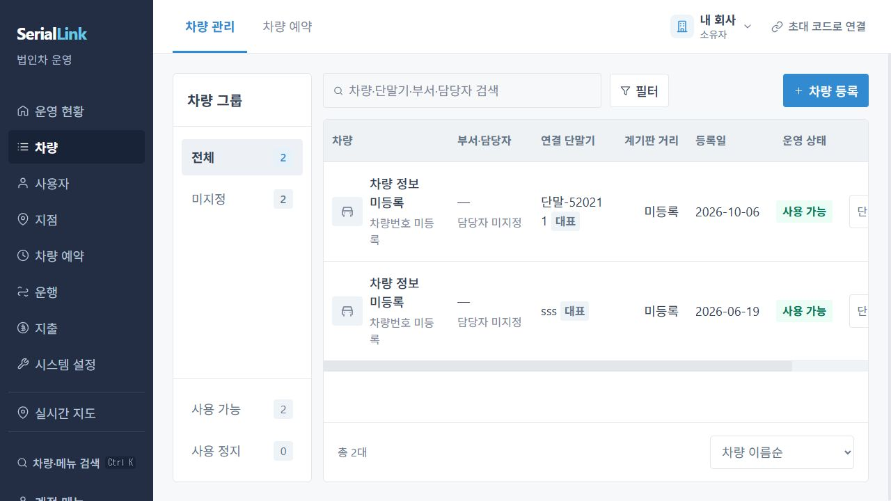
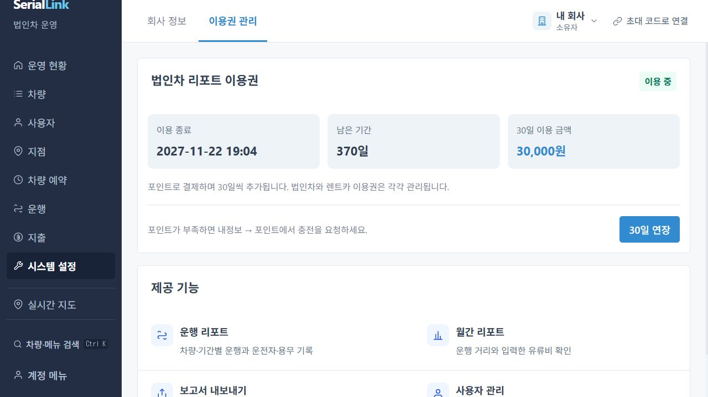

# 146차 운영 반영 증거

2026-11-18 실제 `gps.serial.kr`의114→115 팀 검토 배포 증거다. [결과·권한 기간·복구 경계](../../operations/location-business-review146-20261118.md)를 함께 읽는다. 합성 화면이 아닌 운영 브라우저 캡처2장이다.

| 파일 | 확인 내용 |
|---|---|
| `staged.json` | 전환 전114·기존 API/웹/환경·이웃 서비스·실행 스크립트 해시 |
| `rehearsal.json` | 실제 사본114→115→114→115, 구/신 API, 신규 입력 존재 시 되돌림 거부, 덤프 복원 |
| `deployment.json` | 18:19:04 실제 전환·기존 운행 보정 및 구독 불변·46.465초 |
| `verified.json` | 공개 파일22개 해시·두 계정 주요 API·비로그인 거부·정책/환경 유지 |
| `backup-verified.json` | 실제 직전 백업 덤프를 별도 DB에 복원·해시 일치 |
| `cleanup.json` | 리허설 DB/파일 정리·복구용 백업 유지·디스크 여유 |
| `postcheck.json` |18:25 최종 상태·HTTP 집계/오류 시각·개발 checkout·이용권 연속 기간 |
| `account-entitlements.json` | 두 계정 법인/렌트카 이용권이 현재부터1년 이상 연속 유효함, 변경0건 |
| `prod-vehicles.jpg` | 새 법인 메뉴/차량 관리, 실제 테스트계정의 차량2대 |
| `prod-subscription.jpg` | 실제 법인 이용권2027-11-22 19:04·370일 |
| `review146_deploy.py` | 이번 배포에 실제 사용한 스크립트 원본 바이트 |
| `review137_deploy.py` | 이번에 import한 백업/복원 공통 함수 원본(137 apply는 실행하지 않음) |
| `review146_postcheck.py`, `check-accounts.py` | 실제 읽기 전용 점검 소스 |
| `checksums.json` | 위14파일의 SHA-256·바이트 수 |

리허설 복사 중 감시502 2건, 준비 완료 뒤 초기429 6건을 숨기지 않고 `postcheck.json`에 기록했다. 다시 진입 후2/2차량 및 월간3건 조회가 완료됐다. 계기판 편집 창의 두 입력은 실제 DOM/AX로 확인하고 저장하지 않았다. 팝업의 빈 캡처는 증거에서 제외했다. 후속 점검 도구 첫 실행의 Python3.10 시간 파싱 오류는 명시적 형식으로 수정했다.

기존145차 Rust119·웹451 및 합성 API/XLSX 검증을 재사용하며 추가 부하 시험은 없다. 실물 송신 성공/정식 보안·암호화·정책 활성화 완료 증거가 아니다.

공개 Git에는 토큰·환경 파일·실제 DB·상세 위치/주소/운행 표를 넣지 않았다. 서버 로그는 IP/내용을 제외한 설치된 경로 템플릿의 집계만 보존했다. 실제 백업은 서버의 root 전용 디렉터리에 남아 있다.

